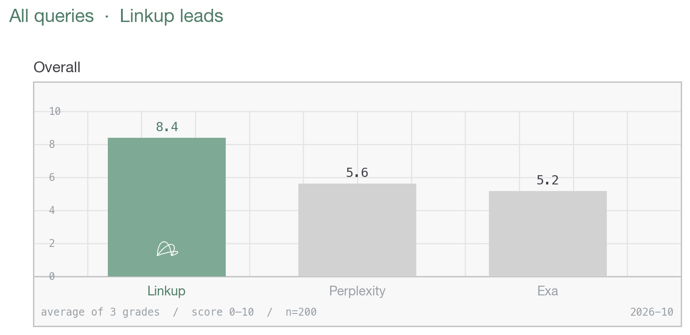

# General consumer & places benchmark

Linkup fast vs Perplexity Search vs Exa fast on Samsung's search-partner evaluation criteria (relevance, completeness of required fields, accuracy). 200 queries, run 2026-10-14. Each query was graded three times. Overall is the average of those three grades. Relevance, completeness, and accuracy were scored on the Opus grade only. Places are queries about a specific physical site. General consumer is the rest.



## Places (112 queries)


| Engine | Overall | Relevance | Completeness | Accuracy |
|---|---|---|---|---|
| **Linkup fast** | **8.32** | 8.72 | 7.42 | 7.76 |
| Perplexity Search | 5.71 | 7.07 | 5.79 | 6.28 |
| Exa fast | 4.99 | 6.41 | 5.50 | 5.77 |

Linkup's average was higher on **112 of 112**.

## General consumer (88 queries)


| Engine | Overall | Relevance | Completeness | Accuracy |
|---|---|---|---|---|
| **Linkup fast** | **8.53** | 8.75 | 7.41 | 8.01 |
| Perplexity Search | 5.52 | 6.69 | 5.30 | 6.47 |
| Exa fast | 5.43 | 6.67 | 5.72 | 6.43 |

Linkup's average was higher on **87 of 88**.

## Queries

| Kind | What they ask |
|---|---|
| Hotels | Fees, parking, cancellation, or house rules at a named hotel |
| Restaurants | Hours, a menu price, or a house rule at a named restaurant |
| Shopping | A product's specs, price, warranty, or carrier compatibility |
| Sports | Entry rules, tickets, or access at a stadium, arena, or event |
| Home services | Price, coverage, or terms from a service company |
| Finance | A rate, fee, or eligibility rule |
| Local business | A policy or practical detail at a named local venue |
| News | A reported fact |
| General search | A practical fact that is not one of the above |

## Repo layout

```
harness.py   run queries through the 3 engines   -> responses.jsonl
grader.py    blind side-by-side LLM judge         -> grades.jsonl
report.py    summary table
assets/make_charts.py           graph-paper charts              -> results/*.png
data/queries.jsonl              200 queries (domain, query)
results/responses_run3.jsonl    raw engine responses from the reported run
results/grades_run3_opus.jsonl  judge scores + notes for the reported run
results/grades_history.csv      the three overall grades averaged in the tables
results/chart.png               all 200 queries
results/places.png              places
results/general.png             general consumer
```

## Run it

```bash
pip install -r requirements.txt
cp .env.example .env    # add LINKUP_API_KEY, PERPLEXITY_API_KEY, EXA_API_KEY, ANTHROPIC_API_KEY
python harness.py data/queries.jsonl results/responses.jsonl
python grader.py results/responses.jsonl results/grades.jsonl --model claude-opus-5-5
python report.py results/grades.jsonl --chart results/my_chart.png
```

Reproduce the reported numbers and chart from the stored grades without any API keys:

```bash
python report.py results/grades_run3_opus.jsonl --chart results/chart.png
```
